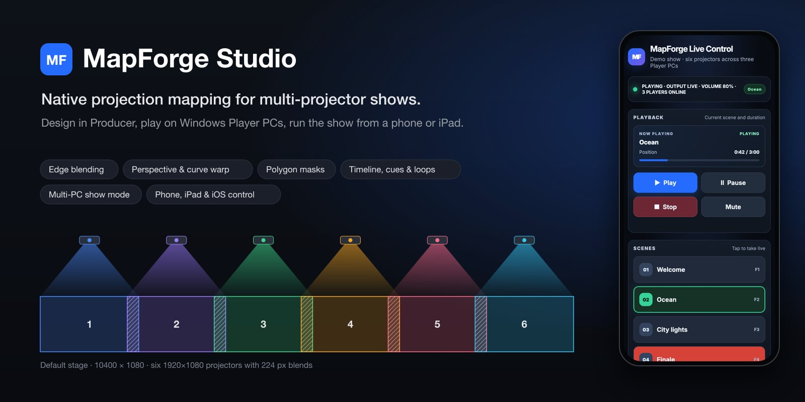
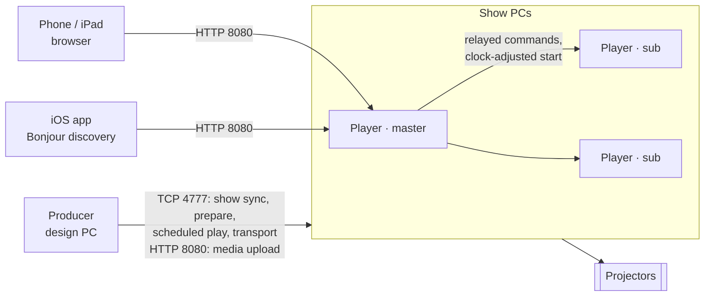
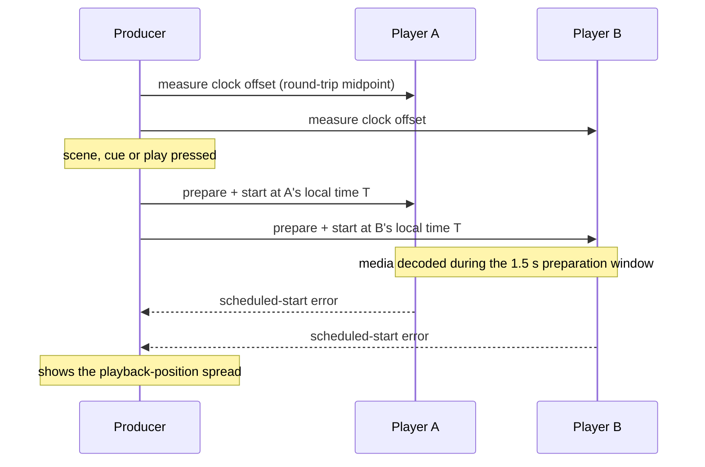
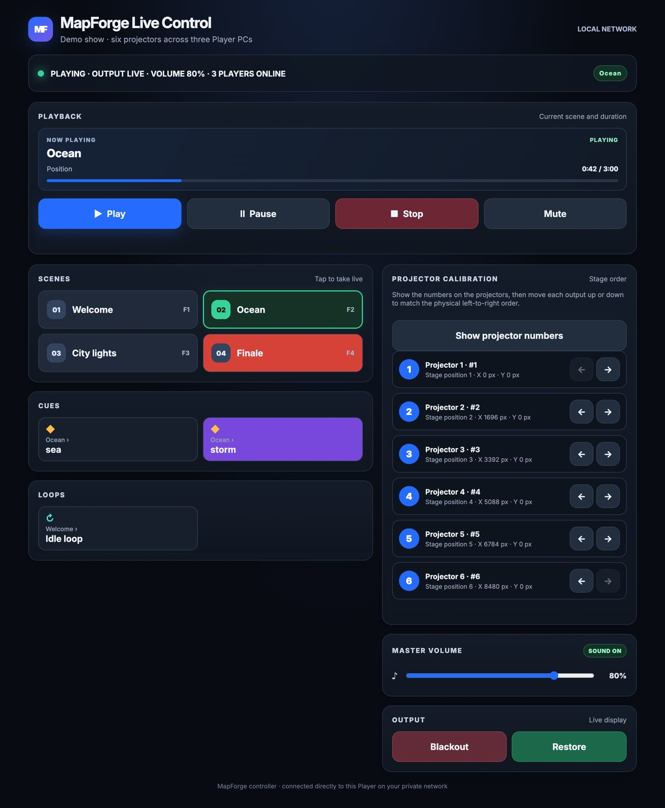
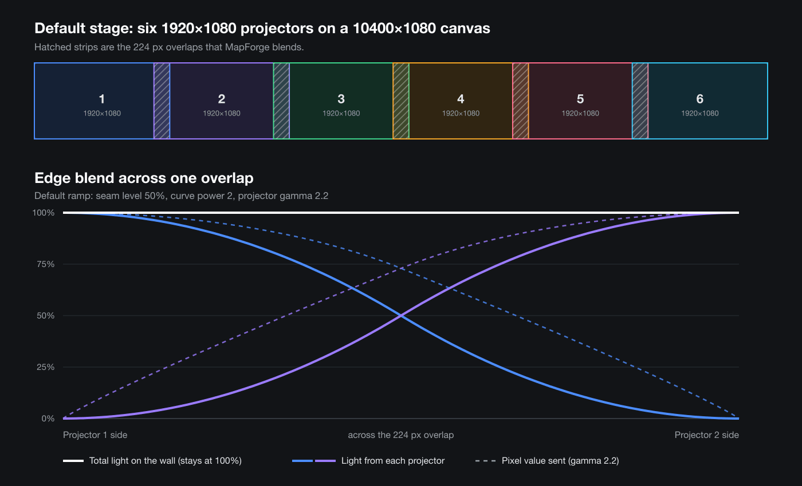

<p align="center">
  
</p>

<h1 align="center">MapForge Studio</h1>

<p align="center">
  <b>Windows-first, native projection mapping: design a multi-projector show in Producer, play it on Player PCs, and run it live from a phone or iPad.</b>
</p>

<p align="center">
  
  
  
  
  
  
  <a href="https://github.com/rexzai1992/Madprojector/releases/latest"></a>
</p>

MapForge is a native projection-mapping prototype. It has a **Producer**
desktop app for building the show, a separate **Player** desktop app that
drives the projectors on each show PC, a versioned show format, a
phone/iPad **browser controller** served by every Player, and a native
**iOS controller** that finds Players on the LAN by itself. The playback UI
is native (Rust + egui/wgpu), not a browser.

> [!NOTE]
> This is a working prototype. Physical display placement, multi-PC timing
> and Windows behaviour still need validation on real projectors and GPUs.
> See [current status](docs/CURRENT_STATUS.md) for exactly what is
> implemented and what is not.

---

## Contents

- [What works now](#what-works-now)
- [How it fits together](#how-it-fits-together)
- [Live controller](#live-controller)
- [Edge blending and geometry](#edge-blending-and-geometry)
- [Install on Windows](#install-on-windows)
- [Running a show](#running-a-show)
- [Development](#development)
- [Configuration](#configuration)
- [Project structure](#project-structure)
- [Troubleshooting](#troubleshooting)
- [Roadmap](#roadmap)
- [Documentation](#documentation)

---

## What works now

**Stage and projectors**
- A resizable virtual stage spanning any number of projector outputs. New
  shows start on a 10400×1080 stage with six 1920×1080 projectors.
- Projectors keep their native resolution and are assigned to Player PCs on
  the LAN; several projectors can share one PC. They can be moved on the
  canvas but never stretched, and changing the canvas size never resizes
  projectors or media.
- Assign each output to a Windows display for borderless, native-size
  fullscreen playback, or keep it in a safe preview window. Projectors with
  no screen chosen fill the extra screens left to right automatically, and
  double-clicking a projector window on the Player PC makes it fill that
  screen (remembered).
- An **Identify** pattern (big number, name, IP, resolution, border, corner
  marks) and grid/white/gray test patterns for alignment.

**Media and timeline**
- Import images, videos and music (or drag and drop them), then drag,
  resize, fit, fill, loop and route layers per projector.
- A timeline with one track per layer: move clips in time or between tracks,
  trim either edge, snap to the playhead, cues and clip edges; thumbnails and
  waveforms.
- **Cues** (named start points) and **loop regions** (repeat forever or N
  times until released), each with its own hotkey and controller button.
- Multiple scenes with assignable hotkeys (default F1–F12), plus Space / Esc
  / B for play-pause, stop and blackout, and M to add a cue. Scene end
  actions: loop, hold last frame, stop or go to the next scene.
- Seamless loops and scene changes: the next pass is pre-rolled 2 s ahead,
  so no black frame appears.
- Undo/redo for every show edit, and copy/paste of layers between scenes.

**Playback**
- Real still-image and FFmpeg video playback with pause, stop and looping,
  continuous across all outputs; music and optional video sound through
  FFmpeg with per-layer volume.
- Live sync: Producer edits reach the Player within about 120 ms.
- Player state and output continue if Producer or the browser disconnects.

**Calibration**
- Edge blending set in percentages, with a curve that keeps the overlap at
  the same brightness, plus per-projector brightness and black lift.
- Projector geometry: Off, four-corner Perspective, Horizontal curve,
  Vertical curve and Full grid (draggable 3×3 mesh).
- Editable hard-edged polygon masks (3–64 points) per projector, saved with
  the show.

**Multi-PC and control**
- TCP commands for project sync, prepare, clock-adjusted scheduled play,
  pause, stop, volume, mute and blackout, with duplicate-command protection
  and explicit protocol versioning.
- LAN tools per Player PC: latency, a 64 MB speed test, media check and
  streamed media upload with SHA-256 verification.
- A browser controller at `http://PLAYER-IP:8080`, customisable from the
  Producer's **Controller** window, and a native iOS controller with Bonjour
  discovery.
- **Show mode** without Producer: each Player is set up once as master or
  sub, keeps the last show and reopens it on start. The master can start the
  show by itself and relays controller commands to the subs so they play
  together; subs copy the show and media from the master. Sound plays on the
  master only by default.

**Shipping**
- Atomic save and reload of schema-versioned JSON projects.
- A Windows installer (NSIS) with bundled FFmpeg, and in-app update bubbles
  fed by GitHub releases.

---

## How it fits together



- **Producer** builds the show and sends it to every Player address. Each
  Player draws only its own projectors; transport commands go to all of
  them.
- **Players** listen on TCP 4777 (show control) and HTTP 8080 (controller,
  media transfer). They keep running if Producer or a controller
  disconnects.
- **Show day without Producer**: the master answers controllers, relays
  their commands to the subs and brings a restarted sub back to the same
  position. Subs copy the show and any missing media from the master.

### How starts stay in sync



Because every command carries a per-Player start timestamp, the order in
which commands arrive no longer decides the start frame. In show mode the
master does the same for its subs with a 0.8 s lead.

---

## Live controller

Every Player serves a phone/tablet controller at `http://PLAYER-IP:8080`
(a sub's page also works; it passes taps to the master). It shows what is
playing, and has transport buttons, scene/cue/loop buttons, projector
identification and ordering, master volume, and blackout/restore.

<p align="center">
  
  <br><sub>The browser controller on a tablet, showing a demo show with six projectors across three Player PCs.</sub>
</p>

From the Producer's **Controller** window you can set the title, note,
accent colour, number of columns and visible sections, plus each scene's
button text, colour and visibility.

**Native iOS controller** (`apps/ios/`): discovers Players with Bonjour on
the local Wi-Fi, connects to the master automatically, remembers the
selected Player and offers a picker if there is more than one master. No IP
address or port to type. Controls: scenes, cues and loops; play, pause,
stop, mute, volume, blackout, restore and exit loop; projector
identification and order. Targets iOS 17 with no third-party dependencies;
build it in Xcode (see [apps/ios/README.md](apps/ios/README.md)).

---

## Edge blending and geometry

<p align="center">
  
</p>

The blend ramp follows Paul Bourke's projector blend: the seam level
(50% by default) makes two opposing ramps sum to full light, the power
shapes the curve, and the projector's gamma converts light into the pixel
value that is sent. The chart above is computed from MapForge's own ramp
with the default settings. The Producer plots each blend and flags
overlaps that are not blended.

After blending, each projector can be corrected with:

| Tool | What it does |
|---|---|
| Brightness / black lift | Match a brighter projector; raise black level outside the feathers |
| Perspective | Four-corner projective correction, dragged in a preview or typed in |
| Horizontal / vertical curve | 3×3 mesh constrained to one axis |
| Full grid | Free 3×3 mesh |
| Polygon mask | 3–64 output-space points; everything outside is blacked out |
| Test patterns | Identify, grid, white, 50% gray |

---

## Install on Windows

Download **MapForge-Setup-&lt;version&gt;.exe** from
[Releases](https://github.com/rexzai1992/Madprojector/releases/latest) (or
from the **Actions → Windows installer** run, artifact *MapForge-Setup*)
and run it on each PC:

- Every show PC: **MapForge Player** (always installed) and **Open the
  Player when Windows starts**.
- The design PC: also tick **MapForge Producer**.

The installer includes FFmpeg, adds Start menu and desktop shortcuts and
the Windows Firewall rules, and adds an uninstaller. The first time the
Player opens it asks whether the PC is the **Master** or a **Sub**.

**Updates.** Every push to `main` is built by GitHub Actions and published
as release `v0.1.<build number>` with two installers: the full
*MapForge-Setup* and a small programs-only *MapForge-Update*. When online,
both apps check for a newer release (shortly after start, then every 30
minutes, Windows only) and show an update bubble that downloads and opens
the update installer.

To build the installer yourself on a Windows PC with Rust (MSVC) and NSIS:

```powershell
powershell -ExecutionPolicy Bypass -File .\scripts\build-windows.ps1
```

It runs the tests, builds `dist\MapForge-Player.exe` and
`dist\MapForge-Producer.exe`, downloads FFmpeg and makes the installers.

---

## Running a show

1. **Start the Players.** On first start each asks **Master PC** or **Sub
   PC**; subs enter the master's IP. The choice is saved and **Change
   setup** reopens it.
2. **Set up projectors in Producer.** In **Edit projectors**, give each
   projector its Player PC IP (or **This PC** for a one-PC setup), its
   resolution and display. The Players menu shows every PC online with its
   latency.
3. **Identify** the projectors and fix any swapped cables or IPs; reorder
   outputs from the controller if needed.
4. **LAN & media**: run **Test speed**, then **Send media** to each PC.
   Files land in the Player's media folder and are checked against their
   SHA-256.
5. **Send the show** to all Players (or to the master only; subs copy it).
6. **Go live** from Producer hotkeys, the browser controller or the iOS
   app. With autostart on, the master waits until every sub answers (up to
   20 s) and then all PCs start the first scene together.

The full step-by-step test plan is in [docs/WINDOWS_TEST.md](docs/WINDOWS_TEST.md).

---

## Development

```bash
cargo test --workspace
cargo run -p mapforge-player
cargo run -p mapforge-producer
```

For a local one-PC test, open the Player first (choose **Master PC**), then
the Producer, leave the Player address as `127.0.0.1:4777` and click
**Connect / Sync Project**. Display enumeration, borderless placement and
the update check are Windows features; elsewhere outputs use preview
windows.

To run two Players on one machine, move the second one's ports:

```bash
MAPFORGE_PORT=4778 MAPFORGE_HTTP_PORT=8081 cargo run -p mapforge-player
```

Tests cover serialization, older-project defaults, blend ramps summing to
full light, output arrangement and auto-blend.

---

## Configuration

MapForge needs no accounts, keys or config files. These optional
environment variables change its behaviour:

| Variable | Used by | Effect |
|---|---|---|
| `MAPFORGE_PORT` | Player | Show-control TCP port (default 4777) |
| `MAPFORGE_HTTP_PORT` | Player | Controller and media HTTP port (default 8080) |
| `MAPFORGE_MEDIA_DIR` | Player | Where received media and `player-settings.json` are stored (default `%USERPROFILE%\MapForge Media`) |
| `MAPFORGE_NO_UPDATE_CHECK` | Producer, Player | Set to `1` to turn off the update check |
| `MAPFORGE_VERSION` | Build | Version stamped into the apps (set by `build-windows.ps1`) |

Network ports to allow on private networks: **TCP 4777** (show control) and
**TCP 8080** (media transfer and the controller). The iOS app also needs
Bonjour (mDNS) on the LAN.

---

## Project structure

```text
Madprojector/
├── Cargo.toml                    Rust workspace (version, shared dependencies)
├── crates/mapforge-core/         show model, schema, protocol, blend maths, update check
├── apps/producer/                Producer: stage, timeline, history, LAN tools
├── apps/player/                  Player: outputs, playback, setup, relay,
│   └── src/controller.html       the browser controller it serves
├── apps/ios/MapForgeController/  native SwiftUI controller (Xcode project)
├── installer/mapforge.nsi        NSIS installer script
├── scripts/build-windows.ps1     test, build, bundle FFmpeg, package
├── .github/workflows/            Windows installer build and release
└── docs/                         plan, status, edge blending, Windows test guide
```

---

## Troubleshooting

| Symptom | What to do |
|---|---|
| Producer cannot reach a Player | Check the IP with `ipconfig` and allow MapForge Player through Windows Firewall on private networks (TCP 4777 and 8080). |
| Video does not play | FFmpeg must be next to the Player (the installer adds it). Still images work without it. |
| A projector shows the wrong part of the stage | Run **Identify projectors**, then fix the cable, the Player PC IP or the order. Windows' internal display numbers can differ from Settings; pick displays by resolution. |
| An output window does not fill its projector | On the Player PC, drag the window onto the projector and double-click it. Press **Esc** or double-click again to get the window back. |
| Speed test reports about 90 Mbit/s | That suggests a 100 Mbit link or Wi-Fi; use gigabit wired LAN for media transfer. |
| The iOS app finds no Player | Keep the phone and master on the same LAN; guest Wi-Fi or client isolation blocks Bonjour. Allow the Player on the private network. |
| SmartScreen warns about the installer | It is not code-signed yet: **More info → Run anyway**. |
| No update bubble | Offline show networks never see it; update with the *MapForge-Update* installer file. |

---

## Roadmap

Not implemented yet (see [docs/CURRENT_STATUS.md](docs/CURRENT_STATUS.md)):

1. Continuous cross-PC drift monitoring and gentle correction.
2. Warp, masking and blending in one linear-light GPU render pass.
3. Feathered masks and multi-point mesh warping beyond the 3×3 grid.
4. Output FPS and dropped-frame telemetry; GPU video decoding.
5. Authenticated WebSocket controller updates instead of polling. There is
   no authentication today, so use MapForge only on a trusted private LAN.

---

## Documentation

- [docs/CURRENT_STATUS.md](docs/CURRENT_STATUS.md): what is implemented, limitations, next slice
- [docs/PROJECTION_MAPPING_SOFTWARE_PLAN.md](docs/PROJECTION_MAPPING_SOFTWARE_PLAN.md): the software plan, source of truth for product scope
- [docs/EDGE_BLENDING_PLAN.md](docs/EDGE_BLENDING_PLAN.md): edge blending design
- [docs/WINDOWS_TEST.md](docs/WINDOWS_TEST.md): install, one-PC, multi-PC and show-mode test steps
- [apps/ios/README.md](apps/ios/README.md): building the iOS controller
